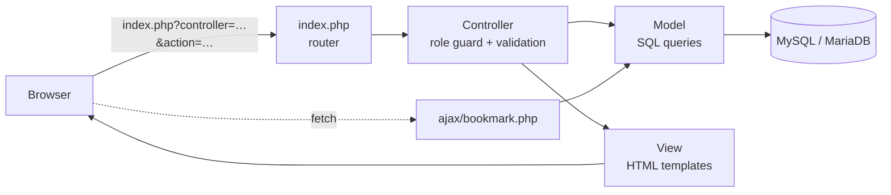

<div align="center">

# CampusXP

**Campus opportunities and recruitment for AIUB, in one place.**

Students find and apply to club drives and jobs. Clubs and recruiters run their whole hiring process. OSA approves and supports it all.


[Quick start](#-quick-start) · [Features](#-features) · [Architecture](#-architecture) · [Routes](#-routes) · [Database](#-database) · [Security](#-security)

</div>

---

## Table of contents

- [Overview](#-overview)
- [Quick start](#-quick-start)
- [Demo accounts](#-demo-accounts)
- [Features](#-features)
- [Tech stack](#-tech-stack)
- [Architecture](#-architecture)
- [Project structure](#-project-structure)
- [Routes](#-routes)
- [Database](#-database)
- [Security](#-security)
- [Troubleshooting](#-troubleshooting)
- [Credits](#-credits)

---

## 📌 Overview

CampusXP replaces scattered Facebook posts, Google Forms and spreadsheets with one platform for four roles:

| Role | Uses CampusXP to |
| :--- | :--- |
| **Student** | Find opportunities, apply with a saved profile, and track every application |
| **Club executive** | Post drives, move applicants through stages, book interviews, request equipment |
| **Recruiter** | Post jobs with screening questions, search students by CGPA and skills, send invitations |
| **Admin (OSA)** | Approve drives and job posts, assign booths, dispatch equipment |

It's plain PHP 8 with procedural `mysqli`: no framework, no Composer, no build step. Copy it into XAMPP and it runs.

---

## 🚀 Quick start

**Requirements:** [XAMPP](https://www.apachefriends.org/) with PHP 8.x and MySQL / MariaDB. Developed and tested on PHP 8.2 and MariaDB 10.4.

1. **Copy the project** into your XAMPP web root:

   ```text
   C:\xampp\htdocs\campusXp\
   ```

2. **Start Apache and MySQL** in the XAMPP Control Panel.

3. **Create the database.** Open [phpMyAdmin](http://localhost/phpmyadmin), click **New**, and create `campusxp_aiub` with collation `utf8mb4_unicode_ci`.

4. **Import the schema and demo data.** Select the database → **Import** → choose `database/schema.sql` → **Import**.

   Or from a terminal:

   ```bash
   C:/xampp/mysql/bin/mysql.exe -u root campusxp_aiub < database/schema.sql
   ```

5. **Open the app** at <http://localhost/campusXp/index.php> and sign in with a [demo account](#-demo-accounts).

> [!NOTE]
> Connection settings are in `config/db.php`: host `localhost`, user `root`, empty password, database `campusxp_aiub`. If `campusxp_aiub` doesn't exist, it falls back to a legacy database named `unipulse_aiub`.

> [!IMPORTANT]
> **Upgrading an older database?** If you imported `schema.sql` before equipment return dates were added, re-import it or run:
>
> ```sql
> ALTER TABLE logistics_requests ADD COLUMN date_return DATE NULL AFTER date_needed;
> ```

---

## 🔑 Demo accounts

Every demo account uses the password **`password123`**.

| Role | Email |
| :--- | :--- |
| Student | `student@aiub.edu` |
| Club executive | `exec@aiub.edu` |
| Recruiter | `recruiter@brainstation-23.com` |
| Admin (OSA) | `admin@aiub.edu` |

Three more students, useful for testing Talent search: `ayesha@student.aiub.edu`, `mahmud@student.aiub.edu`, `nusrat@student.aiub.edu`.
New users can register as a student, club executive or recruiter from the sign-up page.

> [!WARNING]
> These credentials are for local demos only. Change or remove them before deploying anywhere public.

---

## ✨ Features

<table>
<tr>
<td width="50%" valign="top">

### Student
- **Profile:** student ID (`XX-XXXXX-X`) and department are fixed at registration. CGPA, skills, CV link and a default statement can be edited.
- **Apply with your profile:** the apply form is pre-filled from the profile and can be edited before submitting.
- **Minimum CGPA check:** blocks applications below a job's required CGPA and explains why.
- **One application per drive:** duplicate applications are rejected.
- **Saved opportunities:** save or unsave instantly, then filter to saved items.
- **Status tracker:** Applied → Review → Interview → Decision.

</td>
<td width="50%" valign="top">

### Club executive
- **Drives:** new drives go to OSA approval before students see them.
- **Applicant board:** drag cards between Applied, Under review, Interview, Selected and Rejected. Filter by drive or show all drives.
- **Interview slots:** create a slot for a room and time, book an applicant into it, or free it again.
- **Equipment:** request sound systems, projectors and more, with needed and return dates.
- **Analytics:** applicants by department, by CGPA range and by most-listed skills.

</td>
</tr>
<tr>
<td width="50%" valign="top">

### Recruiter
- **Job posts with screening questions:** link, short-answer or paragraph responses. Job posts also need OSA approval.
- **Talent search:** filter students by department, minimum CGPA and skill.
- **Shortlists and invitations:** save searches and send invitations that appear on the student's Opportunities page.
- **Applicant board:** the same stage board as clubs, including screening answers.
- **Equipment:** request screens, booths and interview desks for campus events.

</td>
<td width="50%" valign="top">

### Admin (OSA)
- **Approvals:** approve or reject club drives and corporate job posts.
- **Booths:** assign campus booth spaces to clubs and companies.
- **Equipment:** move requests through Requested → Approved → Dispatched → Returned, or reject them.
- **Overview:** pending approvals, live drives and all registered accounts.

</td>
</tr>
</table>

---

## 🧰 Tech stack

| Layer | Technology |
| :--- | :--- |
| Server | PHP 8.x, procedural `mysqli` with prepared statements |
| Database | MySQL / MariaDB, InnoDB, `utf8mb4` |
| Front end | Server-rendered PHP views, one hand-written stylesheet, vanilla JavaScript |
| Fonts | Plus Jakarta Sans (Google Fonts) |
| Hosting (local) | XAMPP (Apache + MariaDB) |

---

## 🏗 Architecture

CampusXP follows a strict **Model–View–Controller** pattern behind a single front controller.



> [!TIP]
> **The MVC rule:** a view never runs SQL, and a model never prints HTML. Controllers read `$_POST` / `$_GET`, sanitize and validate input, call the model, then `require` the view.

---

## 📁 Project structure

<details>
<summary><b>Show folder tree</b></summary>

```text
campusXp/
├── index.php                   Front controller: the only entry point (router)
├── README.md
├── PRODUCT.md                  Product context: users, brand and design principles
│
├── config/
│   └── db.php                  DB connection, cleanInput(), flash messages, session auth helpers
│
├── database/
│   └── schema.sql              Schema + demo seed data (15 tables)
│
├── models/                     M: every SQL query lives here
│   ├── UserModel.php           Accounts and registration
│   ├── StudentModel.php        Profile, applications, saved opportunities
│   ├── DriveModel.php          Club drives and corporate job posts
│   ├── ApplicationModel.php    Club application pipeline and statuses
│   ├── InterviewModel.php      Interview slots
│   ├── RecruiterModel.php      Screening questions, applicants, talent search, shortlists, outreach
│   ├── LogisticsModel.php      Equipment requests
│   └── AdminModel.php          Approval queue, booths, admin metrics
│
├── controllers/                C: request handling, validation, role guards
│   ├── AuthController.php
│   ├── StudentController.php
│   ├── ExecutiveController.php
│   ├── RecruiterController.php
│   └── AdminController.php
│
├── views/                      V: presentation only
│   ├── layouts/                header.php (sidebar app shell), footer.php
│   ├── auth/                   login, register
│   ├── student/                dashboard (Opportunities), applications, profile
│   ├── executive/              dashboard, kanban, scheduler, logistics, analytics
│   ├── recruiter/              dashboard, create_drive, kanban, talent_search, shortlists, outreach, logistics
│   └── admin/                  dashboard, moderation, booths, logistics
│
├── ajax/
│   └── bookmark.php            Save / unsave an opportunity (signed-in students only)
│
├── assets/
│   ├── css/style.css           AIUB navy palette, sidebar layout, shared components
│   └── js/
│       ├── main.js             Modals, toast messages, HTML escaping
│       ├── student.js          Filters, apply pre-fill, CGPA check, save toggle, profile preview
│       ├── executive.js        Drag-and-drop applicant board
│       ├── recruiter.js        Screening question builder, job title validation
│       └── admin.js            Booth details modal
│
└── docs/                       Project proposal and course outcome (CO3, CO4) documents
```

</details>

---

## 🧭 Routes

Every request goes through `index.php?controller=<module>&action=<action>`.

<details>
<summary><b>Show all routes</b></summary>

| Role | `controller=` | Pages | Form / POST actions |
| :--- | :--- | :--- | :--- |
| Everyone | `auth` | `login`, `register` | `logout` |
| Student | `student` | `dashboard` (Opportunities), `applications`, `profile` | `apply`, `update_profile` |
| Club executive | `executive` | `dashboard`, `kanban`, `scheduler`, `logistics`, `analytics` | `create_drive`, `update_status`, `create_slot`, `assign_slot`, `clear_slot`, `request_logistics` |
| Recruiter | `recruiter` | `dashboard`, `create_drive`, `kanban`, `talent_search`, `shortlists`, `outreach`, `logistics` | `save_drive`, `update_status`, `create_bucket`, `send_outreach`, `request_logistics` |
| Admin | `admin` | `dashboard`, `moderation`, `booths`, `logistics` | `moderate_action`, `booth_action`, `logistics_action` |

</details>

- An unknown action falls back to that role's dashboard.
- Each controller has a role guard: `checkStudentAuth()`, `checkExecAuth()`, `checkRecruiterAuth()` or `checkAdminAuth()`. Signed-out or wrong-role requests are redirected to sign-in.

---

## 🗄 Database

15 InnoDB tables, created and seeded by `database/schema.sql`.

<details>
<summary><b>Show all tables</b></summary>

| Table | Purpose |
| :--- | :--- |
| `users` | Accounts, roles and password hashes |
| `student_profiles` | Student ID, department, CGPA, skills, CV link, default statement |
| `opportunity_bookmarks` | Opportunities a student has saved |
| `club_drives` | Club drives and events, with approval status |
| `club_applications` | Applications to club drives and their pipeline stage |
| `interview_slots` | Interview room and time slots, and who is booked |
| `candidate_evaluations` | Applicant ratings and remarks *(table exists, not used by the app yet)* |
| `corporate_drives` | Recruiter job posts with minimum CGPA |
| `custom_form_fields` | Screening questions attached to job posts |
| `corporate_applications` | Applications to job posts, including screening answers |
| `recruiter_shortlists` | Saved talent searches |
| `recruiter_outreach_logs` | Invitations sent to students |
| `approval_requests` | OSA approval queue |
| `venue_booth_allocations` | Booth assignments |
| `logistics_requests` | Equipment requests with needed and return dates |

</details>

---

## 🔒 Security

| Concern | How it's handled |
| :--- | :--- |
| SQL injection | Every query that uses user input goes through `mysqli_prepare()` + `mysqli_stmt_bind_param()`. Queries with no user input use `mysqli_query()`. |
| XSS | Input is cleaned with `cleanInput()`. Output is escaped with `htmlspecialchars()`. |
| Passwords | `password_hash(..., PASSWORD_BCRYPT)` to store, `password_verify()` to check. |
| Access control | Role guards on every controller; `ajax/bookmark.php` accepts signed-in students only. |
| Remember me | Remembers the email for 30 days in an `HttpOnly` cookie. It doesn't keep the user signed in. |
| Input validation | Student ID must match `XX-XXXXX-X`. Duplicate IDs and emails are rejected. Link answers are checked with `filter_var(..., FILTER_VALIDATE_URL)`. |

---

## 🛠 Troubleshooting

| Problem | Fix |
| :--- | :--- |
| `Database Connection failed` | Start MySQL in XAMPP and check that the `campusxp_aiub` database exists. |
| Blank page or 404 | Check the folder is `htdocs/campusXp/` and open `index.php` directly. |
| Can't sign in with a demo account | Re-import `database/schema.sql`. The demo users are created by the seed data. |
| Equipment pages error on `date_return` | Run the `ALTER TABLE` in [Quick start](#-quick-start), or re-import the schema. |

---

## 🎓 Credits

Developed for the **Web Technologies** course at the **American International University – Bangladesh (AIUB)** by the **CampusXP Development Team**, Academic Year 2026.
